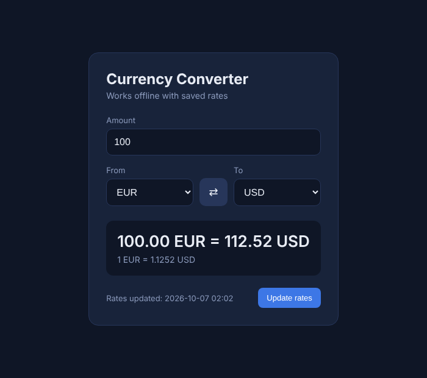

# Currency Converter

Консольный конвертер валют на C++17 с офлайн-кэшем.

Программа загружает курсы валют с публичного API, сохраняет их в файл и после этого может работать без интернета. При каждой конвертации показывается дата последнего обновления курсов.

```
> currency convert 100 EUR USD
100.00 EUR = 112.52 USD
Rate: 1 EUR = 1.1252 USD
Rates updated: 2026-10-07 02:02
```

## Возможности

- конвертация между 160+ валютами
- кэширование курсов в файл (кэш считается свежим 12 часов)
- работа офлайн: если сети нет, используются сохранённые курсы
- дата последнего обновления курсов в каждом ответе
- обработка ошибок: нет сети, плохой ответ сервера, повреждённый кэш, неверный ввод
- небольшая веб-версия на React в папке `web`

## Что используется

- C++17, CMake
- [cpr](https://github.com/libcpr/cpr) — HTTP-запросы
- [nlohmann/json](https://github.com/nlohmann/json) — работа с JSON
- API курсов: https://open.er-api.com (бесплатный, без ключа)

Библиотеки скачиваются автоматически через CMake FetchContent, отдельно ставить их не нужно.

## Сборка

Нужны: компилятор с поддержкой C++17, CMake 3.16+, Git и интернет при первой сборке.

Первая сборка занимает несколько минут, потому что вместе с программой собирается libcurl.

### Windows (Visual Studio)

```
cmake -S . -B build
cmake --build build --config Release
```

Программа появится в `build\Release\currency.exe`.

### Linux

```
sudo apt install build-essential cmake git libssl-dev
cmake -S . -B build -DCMAKE_BUILD_TYPE=Release
cmake --build build
```

Программа появится в `build/currency`.

## Использование

| Команда | Что делает |
| --- | --- |
| `currency convert <сумма> <из> <в>` | конвертирует сумму |
| `currency update` | принудительно скачивает свежие курсы |
| `currency list` | показывает все валюты и курсы |
| `currency status` | показывает информацию о кэше |
| `currency help` | показывает справку |

Примеры:

```
> currency convert 2500 rub eur
2500.00 RUB = 26.16 EUR
Rate: 1 RUB = 0.0105 EUR
Rates updated: 2026-10-07 02:02

> currency status
Cache file: C:\Users\user\.currency_cache.json
Currencies: 166
Rates updated: 2026-10-07 02:02
Downloaded: 2026-10-08 17:48 (0 h ago)
Cache is fresh
```

Без интернета (кэш устарел, но сеть недоступна):

```
> currency convert 100 EUR USD
Warning: network error: Could not resolve host: open.er-api.com
100.00 EUR = 112.52 USD
Rate: 1 EUR = 1.1252 USD
Rates updated: 2026-10-07 02:02 (offline, from cache)
```

## Как работает кэш

1. Программа читает файл `.currency_cache.json` из домашней папки пользователя.
2. Если кэш есть и ему меньше 12 часов — курсы берутся из него, запроса в сеть нет.
3. Иначе программа скачивает курсы с API и перезаписывает файл.
4. Если скачать не получилось, но старый кэш есть — используются старые курсы с пометкой `offline`.
5. Если нет ни сети, ни кэша — программа выводит ошибку и завершается с кодом 1.

Все курсы хранятся относительно доллара, поэтому конвертация считается так:
`результат = сумма / курс(из) * курс(в)`.

## Структура проекта

```
currency-converter/
├── CMakeLists.txt
├── src/
│   ├── main.cpp         разбор команд и вывод
│   ├── rates.h          структура с курсами
│   ├── api.h/.cpp       загрузка курсов из сети
│   ├── cache.h/.cpp     сохранение и чтение кэша
│   └── converter.h/.cpp конвертация, проверка ввода, формат даты
└── web/
    ├── index.html
    ├── style.css
    └── app.js
```

## Веб-версия

В папке `web` лежит небольшая страница с той же логикой: курсы загружаются с того же API и кэшируются в `localStorage`, поэтому страница тоже работает офлайн.

Чтобы запустить, достаточно открыть `web/index.html` в браузере.



## Что можно улучшить

- выбор базовой валюты и времени жизни кэша через аргументы
- история курсов за несколько дней
- unit-тесты для конвертации и разбора ввода
